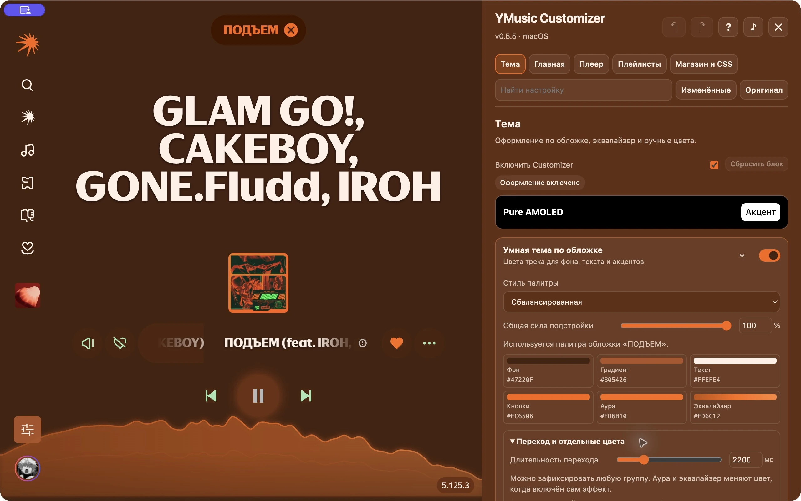
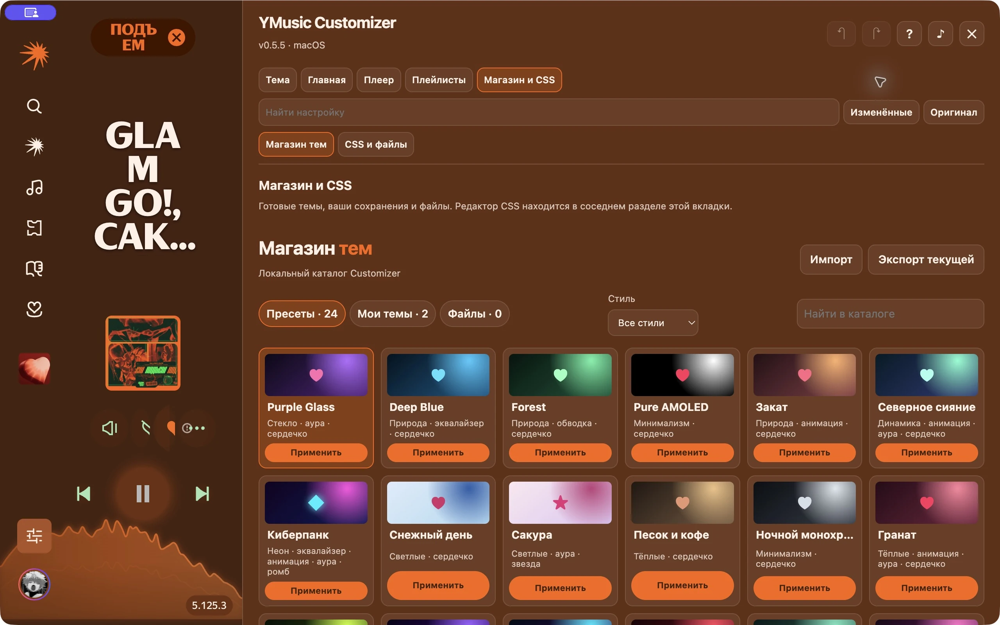

  

# YMusic Customizer

Темы, визуализатор и свой плеер для настольной Яндекс Музыки. Оформление может меняться вместе с обложкой трека, а то, что хочется оставить своим — например, цвет текста или сердечка, — можно закрепить вручную.

[**↓ Скачать для macOS**](https://github.com/nautro09/ymusic-customizer/releases/latest/download/YMusic-Customizer-macOS.zip) · [**↓ Скачать для Windows**](https://github.com/nautro09/ymusic-customizer/releases/latest/download/YMusic-Customizer-Windows.zip) · [Что нового](https://github.com/nautro09/ymusic-customizer/releases) · [Установка](#установка)

*«Моя волна» с адаптивными цветами, аурой артиста и визуализатором в виде волны.*

## Что можно изменить

| Раздел | Что внутри |
| --- | --- |
| **Тема** | Палитра по обложке, фото или видео на фоне, шрифты, скругления, сердечки и защита контраста. Визуализатор: волна, столбцы, контур, сегменты или точки. |
| **Главная** | Аура и обводка портрета, кнопки, обложка и строка трека «Моей волны». |
| **Плеер** | Нижняя панель и расширенный плеер. Discord Rich Presence с обложкой, прогрессом, предпросмотром и ссылкой на трек при её наличии. |
| **Плейлисты** | Градиент шапки, кнопки, фильтры, поиск и цвет стрелок навигации. |
| **Магазин и CSS** | 24 встроенные темы, свои пресеты, импорт и экспорт `.ymctheme`, редактор CSS. |

Откройте **?** в редакторе для подсказок по вкладке. Поиск находит нужные настройки, **Изменённые** показывает правки, а **Оригинал** позволяет сравнить оформление со штатным.

## Галерея

**Палитра по обложке.** Цвета фона, текста, кнопок, ауры и визуализатора видны прямо в редакторе. Силу и скорость перехода можно менять, отдельные группы — отключать. Автоцвет визуализатора использует один оттенок с переходом по яркости.

**Магазин тем.** Можно начать с готового пресета, например Pure AMOLED, Forest или «Киберпанк», а потом сохранить свою версию. Каталог работает локально.

*Скриншоты сделаны в приложении на macOS с Customizer 0.5.5. Показанные настройки доступны в 0.5.6.*

## Установка

Сначала установите официальную настольную Яндекс Музыку. В GitHub Releases скачайте архив для своей системы из **Assets / Файлы релиза**.

| | Как запустить | Открыть редактор |
| --- | --- | --- |
| **macOS** · Apple Silicon и Intel | Распакуйте архив, откройте **YMusic Customizer.app** и нажмите **Установить**. Установщик создаст отдельную копию Яндекс Музыки. [Инструкция для Mac](macos/README.md) | **⌘⇧Y** |
| **Windows 10/11** | Распакуйте архив целиком, запустите **УСТАНОВИТЬ.bat** и перезапустите Яндекс Музыку. [Инструкция для Windows](windows/README.md) | **Ctrl+Shift+Y** |

> [!IMPORTANT]
> **macOS: Apple не удалось проверить приложение.** Установщик 0.5.6 не заверен Apple. Если вы скачали его из этого репозитория и доверяете файлу, после первой попытки запуска откройте **Системные настройки → Конфиденциальность и безопасность** и подтвердите запуск именно этого приложения. [Что делать при предупреждении](macos/README.md#если-macos-не-открывает-установщик) · [Инструкция Apple](https://support.apple.com/ru-ru/102445)

## Обновления

С версии **0.5.6** Customizer проверяет GitHub Releases при запуске. В редакторе раскройте **Обновления**, посмотрите список изменений и нажмите **Обновить и перезапустить**. Перед установкой Customizer проверяет подпись списка версий и контрольную сумму архива.

На Mac онлайн-обновление работает, когда версия официальной Яндекс Музыки совпадает с версией установленной копии. Если Яндекс Музыка уже обновилась отдельно, используйте установщик Customizer. Совместимость с новыми версиями клиента может потребовать обновления мода.

## Исходники и обратная связь

[macOS](macos) · [Windows](windows) · [Сборка и выпуск](docs/RELEASING.md) · [Сообщить о проблеме](https://github.com/nautro09/ymusic-customizer/issues/new/choose) · [Лицензия MIT](LICENSE)

YMusic Customizer — независимый проект. Он работает с установленной настольной Яндекс Музыкой, которая в архивы не входит.
