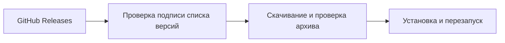

<h1 align="center">
  
</h1>

  <strong>Палитра по обложке, живой визуализатор и свой плеер.</strong> 
  Собери тему с нуля или начни с одного из 24 пресетов.

  
  

  <a href="#галерея">Галерея</a> ·
  <a href="#возможности">Возможности</a> ·
  <a href="#установка">Быстрый старт</a> ·
  <a href="#обновления">Обновления</a> ·
  <a href="https://github.com/nautro09/ymusic-customizer/releases">Все релизы</a>

## Галерея

**Моя волна.** Цвета интерфейса меняются вместе с треком. Аура повторяет силуэт артиста, а визуализатор откликается на музыку.

<table>
  <thead>
    <tr>
      <th width="50%">01 · Палитра по обложке</th>
      <th width="50%">02 · Магазин тем</th>
    </tr>
  </thead>
  <tbody>
    <tr>
      <td></td>
      <td></td>
    </tr>
    <tr>
      <td>Посмотри, какие цвета взяты из трека, и настрой силу перехода.</td>
      <td>Выбери пресет по стилю или сохрани свой вариант.</td>
    </tr>
  </tbody>
</table>

*Реальные кадры из Customizer 0.5.5 на macOS, 2560 × 1600, без обрезки. Нажми на любой кадр, чтобы рассмотреть элементы. В 0.5.7 шапка редактора стала компактнее, а кнопка обновлений переехала вниз.*

**Новое в [0.5.7](https://github.com/nautro09/ymusic-customizer/releases/tag/v0.5.7):** 14 готовых узоров и свои символы, аура в такт музыке, регулируемая ширина редактора, скрытие фото и подписей на главной и отдельное управление значками в углу.

У эквалайзера, узоров, ауры и плейлистов есть отдельный режим «Предпросмотр». Изменения видны в образце и сохраняются кнопкой **Применить**.

В **0.7.0** на вкладке **Главная** можно перенести панель навигации на любую сторону, переставить пункты и скрыть лишние. Для «Моей волны» доступны дымка, ленты и орбиты, а вокруг портрета — лента, которая реагирует на бас. Адаптивная обложка освобождает место для портрета и увеличивается, когда его нет. После обновления окно «Что нового» предлагает пройти только изменившиеся настройки.

## Возможности

| Раздел | Что можно настроить |
| --- | --- |
| **Тема** | Цвета по обложке, фото или видео, узоры и свои символы на фоне, шрифты, сердечки и контраст. Для визуализатора: волна, столбцы, контур, сегменты или точки. |
| **Главная** | Аура с реакцией на бас, видимость портрета и подписей, кнопки «Моей волны» и значки в правом нижнем углу. |
| **Плеер** | Нижняя панель и расширенный плеер. Активность Discord с обложкой, прогрессом, предпросмотром и ссылкой на трек, если она доступна. |
| **Плейлисты** | Градиент шапки, кнопки, фильтры, поиск и цвет стрелок навигации. |
| **Магазин и CSS** | 24 встроенные темы, свои пресеты, импорт и экспорт `.ymctheme`, редактор CSS. |

В редакторе есть поиск, список изменённых настроек и кнопка **Оригинал** для сравнения со штатным оформлением. Кнопка **?** открывает подсказки по текущей вкладке. Потяни левую границу редактора, чтобы сделать его шире; двойной щелчок по границе вернёт минимальную ширину.

<strong>Три идеи, с чего начать</strong>

- **Взять цвета из трека.** Открой **Тема → Умная тема по обложке**. Подбери силу и длительность перехода. В **Переход и отдельные цвета** можно отключить, например, подстройку текста и оставить его цвет из своей темы.
- **Подчеркнуть силуэт артиста.** Открой **Главная → Портрет артиста** и попробуй ауру или обводку. Толщина и интенсивность регулируются отдельно.
- **Исправить шапку плейлиста.** Открой **Плейлисты → Фон шапки плейлиста**, выбери цвет из темы или свой градиент. Если стрелки теряются на фоне, настрой их в **Стрелки назад и вперёд**.

## Установка

1. Установи официальную настольную Яндекс Музыку.
2. Скачай архив для своей системы из [последнего релиза](https://github.com/nautro09/ymusic-customizer/releases/latest) и распакуй целиком.
3. Запусти установщик и открой редактор:

| Система | Установщик | Редактор |
| --- | --- | --- |
| **macOS** · Apple Silicon и Intel | Открой **YMusic Customizer.app** и нажми **Установить**. Он создаст отдельную копию Яндекс Музыки. [Инструкция для Mac](macos/README.md) | **⌘⇧Y** |
| **Windows 10/11** | Запусти **УСТАНОВИТЬ.bat** и перезапусти Яндекс Музыку. [Инструкция для Windows](windows/README.md) | **Ctrl+Shift+Y** |

> [!IMPORTANT]
> **macOS: Apple не удалось проверить приложение.** Установщик 0.7.0 не заверен Apple. Если архив скачан из этого репозитория и ты доверяешь файлу, после первой попытки запуска открой **Системные настройки → Конфиденциальность и безопасность** и подтверди запуск именно этого приложения. [Подробные шаги](macos/README.md#если-macos-не-открывает-установщик) · [Инструкция Apple](https://support.apple.com/ru-ru/102445)

## Обновления

Customizer проверяет GitHub Releases при запуске. В **0.5.7** о новой версии сообщит плашка справа сверху. Её можно закрыть или смахнуть. Список изменений и ручная проверка находятся в кнопке **Обновления** внизу редактора. Для перехода с **0.5.6** открой **Обновления** под строкой поиска и нажми **Обновить и перезапустить**.

На Mac онлайн-обновление доступно, когда версия официального клиента совпадает с версией копии Customizer. Если Яндекс Музыка уже обновилась отдельно, используй установщик Customizer. Совместимость с новой версией клиента может потребовать обновления мода.

## Исходники и обратная связь

[macOS](macos) · [Windows](windows) · [Сборка и выпуск](docs/RELEASING.md) · [Сообщить о проблеме или предложить идею](https://github.com/nautro09/ymusic-customizer/issues/new/choose) · [Лицензия MIT](LICENSE)

YMusic Customizer — независимый проект. Для работы нужен установленный настольный клиент Яндекс Музыки.
