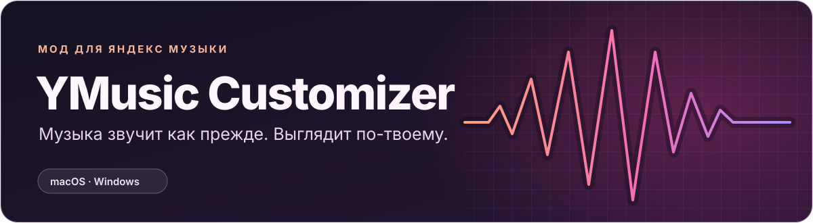
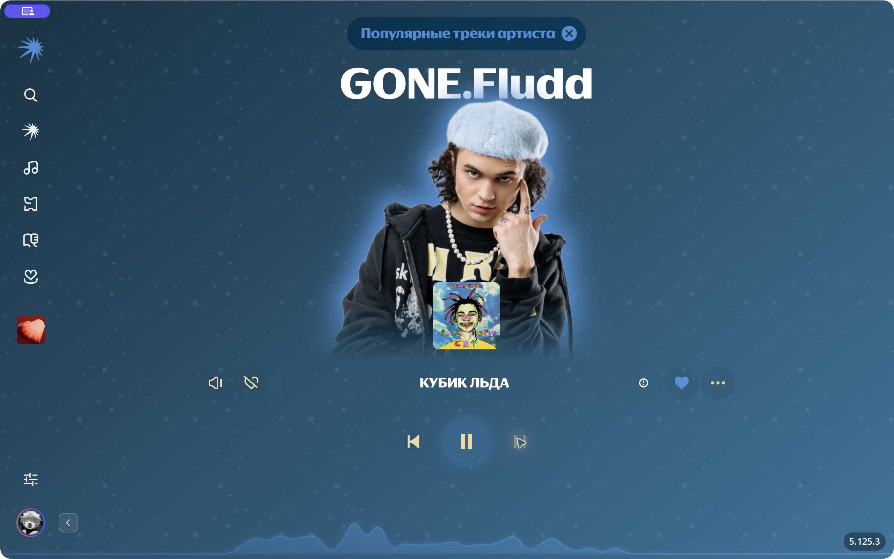
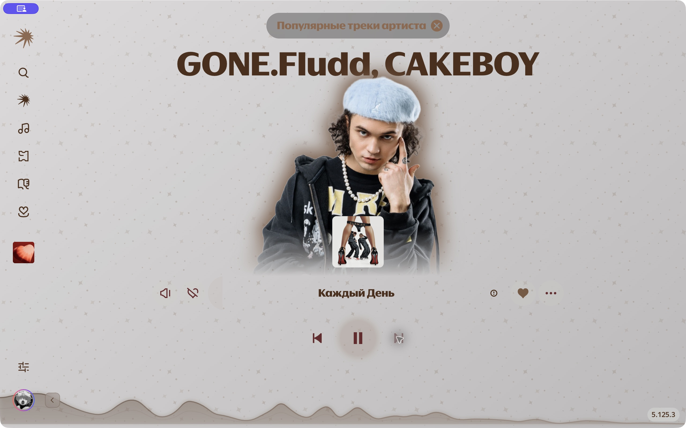
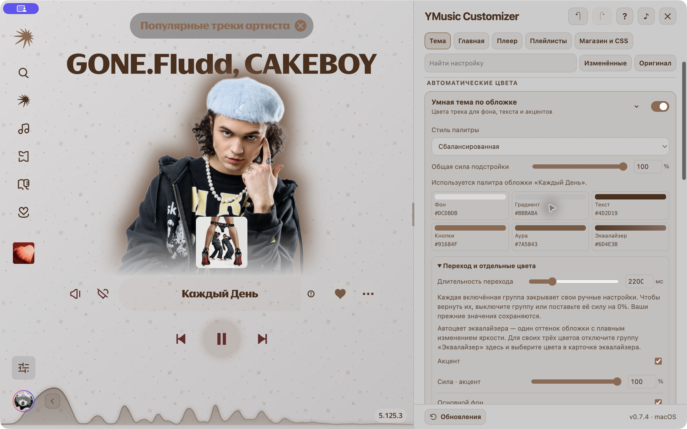
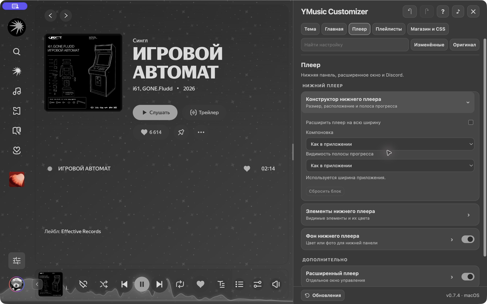
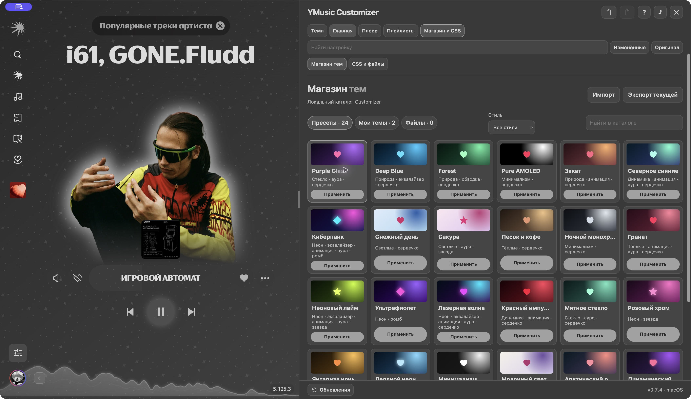
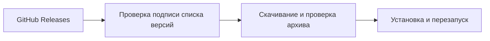

<h1 align="center">
  
</h1>

  <strong>Яндекс Музыка в цветах текущего трека.</strong> 
  Умная тема по обложке, аура артиста в такт музыке и плеер, который можно собрать под себя.

  
  

  <a href="#умная-тема">Умная тема</a> ·
  <a href="#возможности">Возможности</a> ·
  <a href="#установка">Быстрый старт</a> ·
  <a href="#обновления">Обновления</a> ·
  <a href="https://github.com/nautro09/ymusic-customizer/releases">Все релизы</a>

## Умная тема

Customizer собирает палитру из обложки текущего трека. Крупные области обложки задают фон, а заметные детали могут дать цвет кнопкам, сердечку и ауре артиста. Для текста подбирается оттенок с учётом контраста, поэтому на светлой обложке фон может остаться светлым, а надписи стать тёмными.

*Все снимки сделаны в Customizer 0.7.4 на macOS. На каждом видно окно целиком, включая навигацию и управление музыкой. Нажми на кадр, чтобы открыть его в исходном размере.*

### Один режим, две обложки

В обоих кадрах выбрана **Сбалансированная** палитра с одинаковыми настройками. Цвета изменились при переключении трека.

<table>
  <thead>
    <tr>
      <th width="50%">«КУБИК ЛЬДА»</th>
      <th width="50%">«Каждый День»</th>
    </tr>
  </thead>
  <tbody>
    <tr>
      <td></td>
      <td></td>
    </tr>
    <tr>
      <td>Голубой с обложки перешёл на фон и ауру, жёлтый — на иконки управления.</td>
      <td>Светлый фон обложки сохранился, а текст и кнопки получили тёмные тёплые оттенки.</td>
    </tr>
  </tbody>
</table>

### Как включить и настроить

1. Открой **Customizer → Тема → Умная тема по обложке** и включи подстройку под текущий трек.
2. Выбери **Стиль палитры**, от спокойного до неонового, и **Общую силу подстройки**. Чем выше значение, тем сильнее оформление меняется под обложку. В карточке сразу видно цвета для фона, градиента, текста, кнопок, ауры и эквалайзера.
3. Раскрой **Переход и отдельные цвета**, чтобы задать длительность перехода и настроить каждую группу отдельно. Например, чтобы вернуть свой цвет текста, выключи **Текст и подписи** или поставь силу этой группы на **0%**. Сохранённый цвет вернётся, а фон и кнопки продолжат подстраиваться.

## Возможности

### Портрет, анимация и фон

В **Главная → Портрет артиста** можно добавить мягкую ауру, обводку или плотное свечение. Настрой цвет, радиус и яркость, а для реакции на бас включи **Пульсировать в такт музыке**. В соседних карточках можно перекрасить штатную анимацию «Моей волны» и включить адаптивную обложку. Она освобождает место для портрета, а когда он исчезает, увеличивается.

Во вкладке **Тема** можно поставить фото, GIF или видео на фон, выбрать один из 14 узоров или ввести свои символы. Эквалайзер рисует звук лентой, столбцами, контуром, сегментами или точками. У него отдельно настраиваются чувствительность, свечение и второй слой.

### Плеер и Discord

Во вкладке **Плеер** можно изменить компоновку нижней панели, выбрать видимые элементы и настроить полосу прогресса. Отсюда же открывается расширенный плеер. В **Статус в Discord** можно настроить карточку с названием, исполнителем, обложкой, прогрессом и ссылкой на трек, когда она доступна.

### Магазин тем и CSS

Во вкладке **Магазин и CSS** собрано **24 пресета** с разными палитрами, формами сердечка и эффектами. Можно отфильтровать их по стилю, сохранить свою тему, перенести её файлом `.ymctheme` или дописать оформление в редакторе CSS.

### Навигация, плейлисты и редактор

| Раздел | Что можно настроить |
| --- | --- |
| **Главная → Панель навигации** | Перенеси панель к любой стороне окна, поменяй порядок пунктов или скрой лишние. Кнопка рядом с профилем сворачивает панель целиком. |
| **Главная → Значки в правом нижнем углу** | Показывай или скрывай номера версий и формат аудио, например FLAC, если клиент их выводит. |
| **Плейлисты** | Настрой градиент шапки, в том числе в «Мне нравится». У кнопок, фильтров, поиска и стрелок навигации есть отдельные цвета. |

В редакторе есть поиск, фильтр **Изменённые** и кнопка **Оригинал** для сравнения со штатным видом. Потяни левую границу редактора, чтобы изменить его ширину, или нажми **?** для подсказок по вкладке. У эквалайзера, узоров, ауры и плейлистов настройки можно сначала посмотреть в режиме **Предпросмотр** и сохранить кнопкой **Применить**.

## Установка

1. Установи официальную настольную Яндекс Музыку.
2. Скачай архив для своей системы из [последнего релиза](https://github.com/nautro09/ymusic-customizer/releases/latest) и распакуй целиком.
3. Запусти установщик и открой редактор.

| Система | Установщик | Редактор |
| --- | --- | --- |
| **macOS** · Apple Silicon и Intel | Открой **YMusic Customizer.app** и нажми **Установить**. Он создаст отдельную копию Яндекс Музыки. [Инструкция для Mac](macos/README.md) | **⌘⇧Y** |
| **Windows 10/11** | Запусти **УСТАНОВИТЬ.bat** и перезапусти Яндекс Музыку. [Инструкция для Windows](windows/README.md) | **Ctrl+Shift+Y** |

> [!IMPORTANT]
> У установщика macOS 0.7.4 локальная подпись. Если появляется сообщение «Apple не удалось проверить приложение», после первой попытки запуска открой **Системные настройки → Конфиденциальность и безопасность**. Подтверди запуск, если скачал установщик из релизов этого репозитория и доверяешь файлу. [Подробные шаги](macos/README.md#если-macos-не-открывает-установщик) · [Инструкция Apple](https://support.apple.com/ru-ru/102445)

## Обновления

Customizer проверяет GitHub Releases при запуске и показывает плашку справа сверху, когда выходит новая версия. Для установки открой **Обновления** внизу редактора и нажми **Обновить и перезапустить**. После перезапуска окно **Что нового** покажет список изменений и предложит пройти обучение по обновлённым настройкам.

На Mac онлайн-обновление доступно, когда версия официального клиента совпадает с версией копии Customizer. Если Яндекс Музыка уже обновилась отдельно, используй установщик Customizer. Совместимость с новой версией клиента может потребовать обновления мода.

## Исходники и обратная связь

[macOS](macos) · [Windows](windows) · [Сборка и выпуск](docs/RELEASING.md) · [Сообщить о проблеме или предложить идею](https://github.com/nautro09/ymusic-customizer/issues/new/choose) · [Лицензия MIT](LICENSE)

YMusic Customizer — независимый проект. Для работы нужен установленный настольный клиент Яндекс Музыки.
